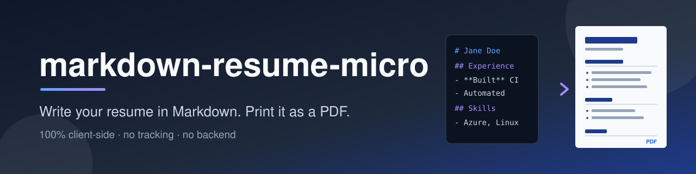
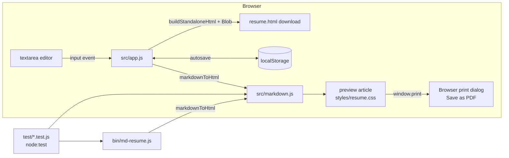

<p align="center">
  
</p>

<p align="center"><b>Write your resume in Markdown. Print it as a PDF. Nothing leaves your browser.</b></p>

<p align="center">
  <a href="LICENSE"></a>
  
  <a href="https://github.com/muhib-karim/markdown-resume-micro/actions/workflows/ci.yml"></a>
</p>

# markdown-resume-micro

A free, open-source Markdown resume builder that runs **100% client-side**. Type Markdown on the left, see a print-ready resume on the right, then save it as a PDF through your browser's print dialog or export a self-contained HTML file. There is no backend, no account, no analytics and no third-party scripts — the app is plain HTML, CSS and vanilla JavaScript ES modules with **zero runtime or dev dependencies**.

## Features

- **Live preview** — the resume re-renders on every keystroke.
- **Print / Save as PDF** — dedicated print stylesheet hides the editor and toolbar and lays out an A4/Letter page; use the browser's "Save as PDF" destination.
- **Export HTML** — downloads a single standalone `.html` file with the resume stylesheet inlined.
- **Open / Save `.md`** — import an existing Markdown file or download your current source.
- **3 themes** — Classic, Modern and Compact (tighter spacing to fit one page).
- **Local autosave** — content and theme are kept in `localStorage` in your browser only; the status line says so if the browser could not save.
- **No tracking** — no network requests besides loading the app's own files; a Content-Security-Policy restricts scripts, styles and connections to the same origin.
- **Safe rendering** — raw HTML in the Markdown is escaped and link URLs are limited to `http(s)`, `mailto`, `tel` and relative links (`javascript:`/`data:` are neutralised). Exported HTML files carry their own Content-Security-Policy that forbids scripts altogether.
- **Keyboard friendly** — every toolbar control and both panes can be reached with <kbd>Tab</kbd>.
- **Offline CLI** — `node bin/md-resume.js` (or `md-resume` after `npm link`) converts a `.md` file into the same standalone HTML from the terminal.

Supported Markdown: `#`–`######` headings, paragraphs, hard line breaks (trailing `\` or two spaces), `**bold**` / `__bold__`, `*italic*` / `_italic_`, `***both***`, `~~strike~~`, `` `code` `` (double backticks work too), `[links](url)`, nested bulleted and numbered lists, `>` blockquotes, `---` rules and fenced code blocks. Tables, images and a few other constructs are not supported (see [Limitations](#roadmap--limitations)).

## Quick start

**Use it online:** <https://muhib-karim.github.io/markdown-resume-micro/> — published by the included GitHub Pages workflow once Pages is enabled for the repository (Settings → Pages → Source: *GitHub Actions*).

**Run locally** (requires only a static file server, because browsers block ES modules over `file://`):

```bash
git clone https://github.com/muhib-karim/markdown-resume-micro.git
cd markdown-resume-micro
python3 -m http.server 8000
# open http://localhost:8000
```

Any static server works (`npx serve`, etc.). There is nothing to install or build.

## Usage

### Web app

1. Edit the Markdown in the left pane (a sample resume is loaded on first visit; **Load sample** restores it).
2. Pick a theme from the toolbar.
3. Click **Print / Save as PDF** and choose *Save as PDF* as the destination. Turning off the browser's "Headers and footers" option gives the cleanest result.
4. Or click **Export HTML** / **Save .md** to download files.

A minimal resume:

```markdown
# Jane Doe

Systems Engineer · Toronto, ON\
[jane@example.com](mailto:jane@example.com) · [github.com/janedoe](https://github.com/janedoe)

## Experience

### Systems Engineer — Example Corp
*2023 – Present*

- Automated provisioning with `Terraform`
- Built CI pipelines with GitHub Actions
```

The first `#` heading becomes the page title and the download filename (e.g. `jane-doe.html`).

### CLI (Node.js 18+)

```bash
node bin/md-resume.js --help
node bin/md-resume.js examples/resume.md -o resume.html --theme modern
node bin/md-resume.js examples/resume.md --output=resume.html --theme=compact
node bin/md-resume.js examples/resume.md > resume.html   # stdout
npm run example                                           # builds examples/resume.html
```

Open the generated HTML in a browser and print to PDF; it prints with the same 14 mm page margins as the web app.

The package is not published to npm. To get an `md-resume` command on your `PATH`, run `npm link` in the repository. Exit codes: `0` success, `1` runtime failure (for example an unreadable input file), `2` usage error. The CLI refuses to write its output over the input file.

## Architecture

The Markdown renderer is a small, pure module with no DOM access, shared by the browser app, the CLI and the test suite.



- `src/markdown.js` — line-based block parser (headings, lists with indentation-based nesting, quotes, fences, rules, paragraphs) plus an inline renderer. All input is HTML-escaped first; formatting is applied to the escaped text, and URLs pass through an allow-list. Generated tags are kept behind placeholders while formatting runs, and the amount of text any one pass sees is bounded, so crafted input can neither break the markup nor stall the page.
- `src/app.js` — DOM wiring: rendering, theme switching, debounced autosave (flushed when the tab is hidden or closed), file import and Blob downloads.
- `src/storage.js` — `localStorage` wrapper that reports whether a write really happened.
- `styles/app.css` — editor/preview layout and the `@media print` rules that hide the UI.
- `styles/resume.css` — resume typography and themes; also inlined, print rules included, into exported HTML.
- `scripts/build-site.js` — copies the static files into `_site/` for GitHub Pages.
- `scripts/lint.js` — the dependency-free lint described below.

## Testing

```bash
npm run lint            # node --check on every JS file + text hygiene + project rules
npm test                # node --test: renderer, CLI, storage, site and browser suites
npm run test:coverage   # the same suites with a coverage gate (needs Node 22+)
npm run build           # assemble the static site into _site/
```

`npm run check` is kept as an alias of `npm run lint`.

The tests use Node's built-in `node:test` runner — no packages to install. They cover inline formatting, block parsing, nested lists, XSS cases (script tags, `javascript:` / `data:` URLs, attribute break-out), inputs that used to freeze or overflow the renderer, CRLF and byte-order-mark input, title/filename extraction, the standalone HTML wrapper, the storage wrapper and the CLI (`--help`, argument errors, exit codes, running through a symlinked `bin`, file and stdout output). `test/site.test.js` checks that `index.html`, `src/app.js` and the Pages build agree with each other.

`test/browser.test.js` drives the real page in headless Chrome or Chromium — keyboard access, contrast, autosave, import, export and print — using only Node built-ins. It needs Node 22+ and a Chrome/Chromium binary (set `CHROME_BIN` if it is not on your `PATH`) and skips itself otherwise. Set `REQUIRE_BROWSER=1` to turn a missing browser into a failure, as CI does.

`scripts/lint.js` syntax-checks every JavaScript file, rejects CRLF, tabs, trailing whitespace and invisible control characters, and enforces three project rules: no dependencies, GitHub Actions pinned to commit SHAs, and no broken relative links in this README.

CI (`.github/workflows/ci.yml`) runs the lint, the tests and the site build on Node 18, 20, 22, 24 and 26; on Node 22 and newer it also enforces the coverage gate (95 % lines, 90 % branches, 90 % functions) and requires the browser tests to run. `.github/workflows/pages.yml` runs the same checks and then deploys `_site/` to GitHub Pages on pushes to `main`. Actions are pinned to commit SHAs and kept current by Dependabot.

## Project structure

```
.
├── index.html               # app shell (toolbar, editor, preview)
├── src/
│   ├── markdown.js          # pure Markdown → HTML renderer
│   ├── app.js               # browser UI logic
│   ├── storage.js           # localStorage wrapper that reports failed writes
│   └── sample.js            # starter resume
├── styles/
│   ├── app.css              # layout + print rules
│   └── resume.css           # resume themes
├── bin/md-resume.js         # CLI
├── examples/resume.md       # sample resume (kept in sync with src/sample.js by a test)
├── scripts/
│   ├── build-site.js        # GitHub Pages build
│   └── lint.js              # dependency-free lint
├── test/                    # node:test suites (unit, CLI, site, headless browser)
├── docs/banner.svg
├── CONTRIBUTING.md
├── SECURITY.md
└── .github/                 # workflows/ci.yml, workflows/pages.yml, dependabot.yml
```

## Roadmap / limitations

- PDF export relies on the browser's print dialog; there is no in-app PDF generator, so output varies slightly between browsers.
- The renderer is a deliberately small Markdown subset — no tables, images, inline HTML, reference-style links, autolinks (`<https://…>`), link titles, backslash escapes or HTML entities (`&nbsp;` is shown literally).
- Unbalanced mixes of bold and italic markers, such as `**a *b***`, can produce mis-nested tags; keep the markers balanced.
- To stay responsive on hostile input, inline formatting is applied to at most 4,000 characters at a time: a longer paragraph is formatted line by line, and a single longer line or list item is shown as plain text. Blockquotes nest at most 32 levels deep.
- Autosave is per-browser `localStorage`; clearing site data deletes it, so keep a `.md` copy with **Save .md**.
- The app needs a browser with ES modules and regular-expression lookbehind: any current Chrome, Edge or Firefox, or Safari 16.4 and newer. The automated browser tests run against headless Chrome only.
- Possible next steps: tables, more themes, a two-column layout, page-break hints.

## Contributing

Issues and pull requests are welcome — see [CONTRIBUTING.md](CONTRIBUTING.md). Before opening a pull request, run `npm run lint` and `npm test`. Please keep each pull request focused and say how you tested it.

To report a security problem, follow [SECURITY.md](SECURITY.md) instead of opening a public issue.

## License

[MIT](LICENSE) © 2026 Muhib Al Karim
