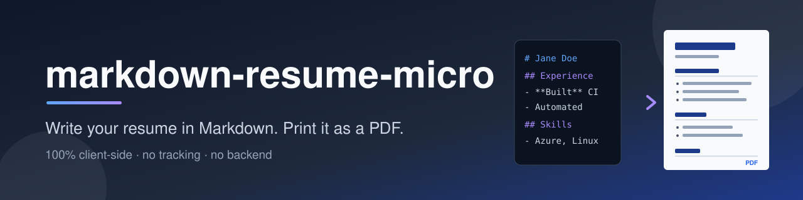
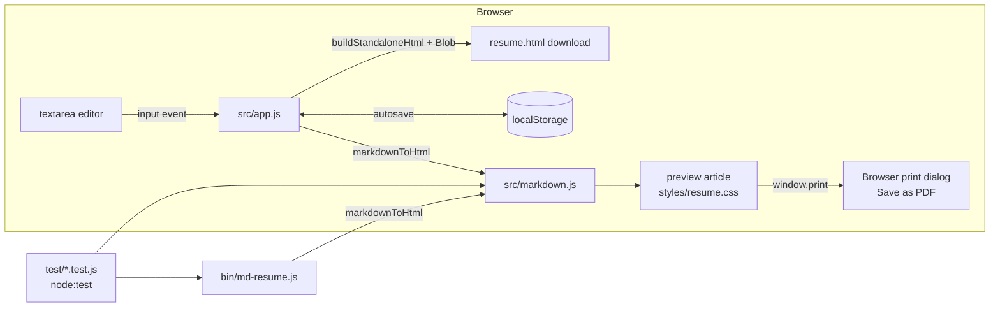

<p align="center">
  
</p>

<p align="center"><b>Write your resume in Markdown. Print it as a PDF. Nothing leaves your browser.</b></p>

<p align="center">
  <a href="LICENSE"></a>
  
  <a href="https://github.com/muhib-karim/markdown-resume-micro/actions/workflows/ci.yml"></a>
</p>

# markdown-resume-micro

A free, open-source Markdown resume builder that runs **100% client-side**. Type Markdown on the left, see a print-ready resume on the right, then save it as a PDF through your browser's print dialog or export a self-contained HTML file. There is no backend, no account, no analytics and no third-party scripts — the app is plain HTML, CSS and vanilla JavaScript ES modules with **zero runtime or dev dependencies**.

## Features

- **Live preview** — the resume re-renders on every keystroke.
- **Print / Save as PDF** — dedicated print stylesheet hides the editor and toolbar and lays out an A4/Letter page; use the browser's "Save as PDF" destination.
- **Export HTML** — downloads a single standalone `.html` file with the resume stylesheet inlined.
- **Open / Save `.md`** — import an existing Markdown file or download your current source.
- **3 themes** — Classic, Modern and Compact (tighter spacing to fit one page).
- **Local autosave** — content and theme are kept in `localStorage` in your browser only.
- **No tracking** — no network requests besides loading the app's own files; a Content-Security-Policy restricts scripts, styles and connections to the same origin.
- **Safe rendering** — raw HTML in the Markdown is escaped and link URLs are limited to `http(s)`, `mailto`, `tel` and relative links (`javascript:`/`data:` are neutralised).
- **Offline CLI** — `md-resume` converts a `.md` file into the same standalone HTML from the terminal.

Supported Markdown: `#`–`######` headings, paragraphs, hard line breaks (trailing `\` or two spaces), `**bold**`, `*italic*`, `~~strike~~`, `` `code` ``, `[links](url)`, nested bulleted and numbered lists, `>` blockquotes, `---` rules and fenced code blocks. Tables and images are not supported (see [Limitations](#roadmap--limitations)).

## Quick start

**Use it online:** <https://muhib-karim.github.io/markdown-resume-micro/> — published by the included GitHub Pages workflow once Pages is enabled for the repository (Settings → Pages → Source: *GitHub Actions*).

**Run locally** (requires only a static file server, because browsers block ES modules over `file://`):

```bash
git clone https://github.com/muhib-karim/markdown-resume-micro.git
cd markdown-resume-micro
python3 -m http.server 8000
# open http://localhost:8000
```

Any static server works (`npx serve`, etc.). There is nothing to install or build.

## Usage

### Web app

1. Edit the Markdown in the left pane (a sample resume is loaded on first visit; **Load sample** restores it).
2. Pick a theme from the toolbar.
3. Click **Print / Save as PDF** and choose *Save as PDF* as the destination. Turning off the browser's "Headers and footers" option gives the cleanest result.
4. Or click **Export HTML** / **Save .md** to download files.

A minimal resume:

```markdown
# Jane Doe

Systems Engineer · Toronto, ON\
[jane@example.com](mailto:jane@example.com) · [github.com/janedoe](https://github.com/janedoe)

## Experience

### Systems Engineer — Example Corp
*2023 – Present*

- Automated provisioning with `Terraform`
- Built CI pipelines with GitHub Actions
```

The first `#` heading becomes the page title and the download filename (e.g. `jane-doe.html`).

### CLI (Node.js 18+)

```bash
node bin/md-resume.js --help
node bin/md-resume.js examples/resume.md -o resume.html --theme modern
node bin/md-resume.js examples/resume.md > resume.html   # stdout
npm run example                                           # builds examples/resume.html
```

Open the generated HTML in a browser and print to PDF.

## Architecture

The Markdown renderer is a small, pure module with no DOM access, shared by the browser app, the CLI and the test suite.



- `src/markdown.js` — line-based block parser (headings, lists with indentation-based nesting, quotes, fences, rules, paragraphs) plus an inline renderer. All input is HTML-escaped first; formatting is applied to the escaped text, and URLs pass through an allow-list.
- `src/app.js` — DOM wiring: rendering, theme switching, debounced autosave, file import and Blob downloads.
- `styles/app.css` — editor/preview layout and the `@media print` rules that hide the UI.
- `styles/resume.css` — resume typography and themes; also inlined into exported HTML.
- `scripts/build-site.js` — copies the static files into `_site/` for GitHub Pages.

## Testing

```bash
npm test          # node --test: 34 tests (renderer + CLI)
npm run check     # node --check syntax check of all JS files
npm run build     # assemble the static site into _site/
```

The tests use Node's built-in `node:test` runner — no packages to install. They cover inline formatting, block parsing, nested lists, XSS cases (script tags, `javascript:` / `data:` URLs, attribute break-out), CRLF input, title/filename extraction, the standalone HTML wrapper and the CLI (`--help`, argument errors, file and stdout output).

CI (`.github/workflows/ci.yml`) runs the syntax check, tests and site build on Node 18, 20 and 22. `.github/workflows/pages.yml` deploys `_site/` to GitHub Pages on pushes to `main`.

## Project structure

```
.
├── index.html               # app shell (toolbar, editor, preview)
├── src/
│   ├── markdown.js          # pure Markdown → HTML renderer
│   ├── app.js               # browser UI logic
│   └── sample.js            # starter resume
├── styles/
│   ├── app.css              # layout + print rules
│   └── resume.css           # resume themes
├── bin/md-resume.js         # CLI
├── examples/resume.md       # sample resume (kept in sync with src/sample.js by a test)
├── scripts/build-site.js    # GitHub Pages build
├── test/                    # node:test suites
├── docs/banner.svg
└── .github/workflows/       # ci.yml, pages.yml
```

## Roadmap / limitations

- PDF export relies on the browser's print dialog; there is no in-app PDF generator, so output varies slightly between browsers.
- The renderer is a deliberately small Markdown subset — no tables, images, inline HTML or reference-style links.
- Autosave is per-browser `localStorage`; clearing site data deletes it, so keep a `.md` copy with **Save .md**.
- Possible next steps: more themes, a two-column layout, page-break hints.

## License

[MIT](LICENSE) © 2026 Muhib Al Karim
